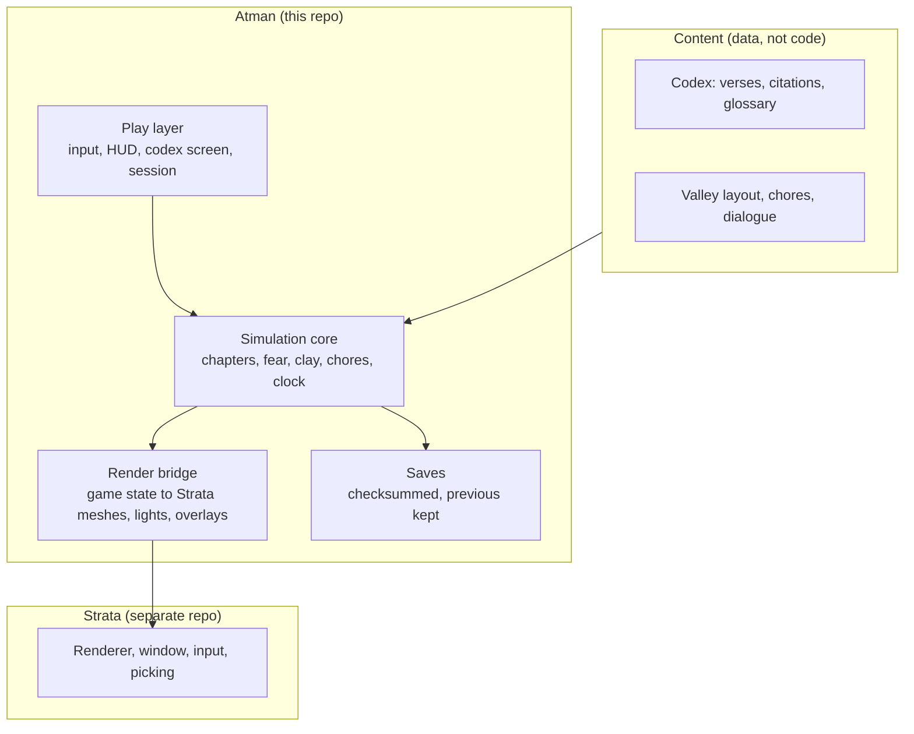

# Architecture

Atman is a C++17 game on [Strata](https://github.com/Preponderous-Software/strata). Implemented
(milestones M1 to M5): the valley's ground, river and village layout with walking and collision,
the game clock, the body's needs, chapter 1, The Rope, chapter 2, Clay and Pots, the prologue's
chores, sleep and the after-mode, and the autopilot with its pinned playthrough (`src/sim/`);
the terrain grid and the village, snake, rope, pot and shard meshes, each paintable through the
clay lens (`src/bridge/geometry.*`), and their upload to Strata (`src/bridge/scene.*`); the sun,
the lamp, the motes, the camera and the HUD (`src/play/view.*`); the codex, its entries and plates
(`content/`, `tools/plates/`, `src/codex/`) and its screen (`src/play/codex_screen.*`); and the
desktop app with its headless tour (`app/main.cpp`). Everything else here is still the plan. The layout follows
[Kindling](https://github.com/Preponderous-Software/kindling), the first game built this way, so
the parts that worked there are reused here.

## Layers

**The engine boundary:** game rules never go into Strata. Strata is a shared engine and takes only
generic features a real consumer needs. Atman may propose engine additions (listed
[below](#engine-additions)), but "a snake becomes a rope after two seconds of lamplight" stays here.

## Source layout

| Path | Contents |
|---|---|
| `src/sim/` | Engine-free, deterministic rules: the valley, the fear meter, snakes and ropes, pots and clay (`clay.*`), the chores, sleep and the after-mode (`chores.*`), the clock, and the autopilot with its route planner (`autopilot.*`) |
| `src/bridge/` | The valley as a terrain grid and meshes (`geometry.*`) and their upload to Strata (`scene.*`), which swaps each coil's snake mesh for its rope mesh when the player sees it, a pot for its shards when it breaks, and every clay colour when the lens turns on |
| `src/codex/` | The codex entries and their plates, built in at compile time by `cmake/embed_codex.cmake`; which entries are open; the PNG decoder (stb_image). No engine. |
| `src/play/` | The sun, camera and HUD (`view.*`) and the codex screen (`codex_screen.*`). Later a `Session` that drives the game for any front end: input, autosave |
| `src/save/` | Save format: magic, version, SHA-256, previous save kept |
| `app/main.cpp` | Desktop entry point |
| `content/` | Codex entries (`codex/*.json`) and their plates (`plates/*.png`); later dialogue |
| `tools/plates/` | Offline renderer and checker for verse plates, and the font (see [Text](#text)) |
| `tests/` | Rules tests, a determinism fingerprint, a full autopilot playthrough |

## Simulation core

- **Fixed tick and no engine types.** The sim runs on a fixed tick and never includes a Strata
  header, so it builds and tests without a GPU.
- **Determinism.** As in Kindling, trig goes through the sim's own deterministic functions (no
  libm `sin`/`cos`), so the fingerprint in `tests/test_determinism.cpp` matches on GCC, Clang and
  MSVC. Any rule change updates the fingerprint in the same pull request.
- **Chapters as state, not scripts.** Each chapter is a set of facts the sim tracks (snakes seen
  through, pots named, pots broken, HUD elements retired). A chapter is complete when its facts
  hold. Nothing is scored.
- **The autopilot is a feature.** It plays the MVP in CI, and in the after-mode it is the avatar
  that keeps living (*prārabdha*, [C5]). The same code serves both. It chooses what to do from the
  World alone and walks there on a visibility graph around the village's obstacles, so the same
  World always gets the same input. Watching is not World state: the free camera lives in the play
  layer, and stepping out or back in changes nothing in the rules.

## Mapping the game to Strata

Everything here exists in Strata 0.4.0 (ABI 1.8) unless marked.

| Game need | Strata feature | Since |
|---|---|---|
| The valley | Lit terrain tile, `strata_set_terrain` | ABI 1.3 |
| Village, pots, the well | Meshes, textured meshes, cube shadow maps | 1.4 / 1.7 |
| Dusk and morning | `strata_solar_position` (NOAA) and `strata_set_sun_direction` | 1.6 |
| The lamp | Point lights (up to 32) | 1.1 |
| Looking closer at a snake | The sim's own line-of-sight test against each coil, so the rule stays deterministic and testable without a GPU (`strata_raycast_meshes`, ABI 1.8, is kept for picking that needs real triangles) | — |
| Snake becomes rope | The bridge removes the coil's snake mesh and adds its rope mesh, built on the same spiral | 1.4 |
| Pots on the wheel | The pot mesh scaled by `strata_set_mesh_transform` as it rises | 1.7 |
| Clay lens | The terrain, village and pots rebuilt with clay in one colour and the rest grey, and uploaded again | 1.3 / 1.4 |
| Space in the pots | Soft points (`STRATA_POINT_SOFT`) with alpha blending at fixed positions from the sim, untouched when a pot mesh is swapped for its shards | 1.5 |
| Codex pages | Each plate uploaded once with `strata_create_texture_rgba8` and drawn on an unlit quad (`STRATA_MESH_UNLIT`) in front of a camera of its own, far from the valley, cleared to the plate's dark colour; the menu is overlay text | 1.7 |
| HUD and its retirement | Overlay text and lines with alpha, faded out by the play layer | 1.5 |
| Mouse look | `strata_set_relative_mouse_mode` | 1.8 |
| Watching the avatar (after-mode) | A free camera in the play layer, and the avatar mesh moved by `strata_set_mesh_transform` | 1.7 |
| Waking | A screen-sized black point in front of the eye, fading out | 1.5 |
| Witness camera (after the MVP) | Free camera with picking, as in steading's fly-cam | 1.8 |
| Dream drift (after the MVP) | `strata_set_mesh_transform` per frame | 1.7 |
| Browser (MVP milestone M6) | WebGL 2 / wasm32 release asset | v0.4.0 |

Strata is fetched with CMake `FetchContent` at a pinned full commit SHA (`ATMAN_STRATA_REF`), and a
local checkout can be used with `-DFETCHCONTENT_SOURCE_DIR_STRATA=<path>`.

## Text

Strata's text overlay uses an 8×8 bitmap font that covers printable ASCII only. Devanagari needs
shaping (conjuncts, vowel signs), and even IAST letters such as ā and ṣ fall outside that range.

The game draws verses as **plates**:

1. `tools/plates/make_plates.py` renders each codex entry offline to a 1600 × 900 PNG, using
   Pillow with libraqm for shaping and Tiro Devanagari Sanskrit (OFL), which also covers IAST. The
   left column is left dark for the game's menu.
2. The PNGs are committed under `content/plates/` beside their entries. Each records a SHA-256 of
   its entry and of the renderer in a PNG text chunk, so `make_plates.py --check` can tell a stale
   plate with plain Python, no Pillow or fonts. CI runs the check.
3. CMake builds the entries and plates into the game (`cmake/embed_codex.cmake`), so it needs no
   files beside it. At run time the codex screen decodes a plate with stb_image the first time it
   is shown and uploads it with `strata_create_texture_rgba8`.

The HUD stays in English ASCII. A UTF-8 glyph-atlas text path in Strata is a possible later engine
addition.

## Codex data

Each codex entry is a JSON file, `content/codex/<order>-<id>.json`, with: an id, its menu line
(ASCII), what opens it (a `CodexId` record, or `always`), a title, the source and verse (for
example "Chāndogya Upaniṣad 6.8.7"), Devanagari and IAST line by line, an English translation, the
translator, the Sanskrit edition, one or more citation IDs from [RESEARCH.md](RESEARCH.md), and
optional notes and readings (the other-schools page uses readings). CI fails if an entry cites an
ID that RESEARCH.md does not define, if a translation has no named translator, if a record opens
no entry or more than one, or if a plate is stale. Where no public-domain translation was checked,
the translator line says the translation is a working one made for Atman and awaiting review.

## Saves

The MVP uses Kindling's approach: a small binary format with a magic number, a version and a
SHA-256 over the body. It is written to a temporary file and renamed into place, and the previous
save is kept. A save that fails its checksum is refused with a message, and the previous one loads.

## Testing

| Test | What it proves |
|---|---|
| Rules tests | Each chapter's facts change only the way the rules say |
| Determinism | A fixed input sequence produces the pinned state fingerprint on every compiler |
| Playthrough | The autopilot plays the MVP from a new game (chores, pots, lens, a broken pot, the snakes, sleep) into the after-mode's first noon, with standing earned only by the first day's chores, and lands on the pinned fingerprint on every compiler (`tests/test_autopilot.cpp`; `atman --headless --autopilot` in CI) |
| No-reward check | Seeing through a snake, or breaking a pot, changes the thing itself and the codex record and nothing else: standing, quests and needs are untouched (`tests/test_rope.cpp`, `tests/test_clay.cpp`) |
| Codex | Every entry's citation IDs exist in RESEARCH.md, and its plate is up to date (`make_plates.py --check`); each record opens exactly one entry, and every built-in plate decodes (`tests/test_codex.cpp`) |
| Saves | Round trip; bit flips are rejected; the previous save survives |
| Headless tour | The desktop app renders fixed camera shots headless, as in Kindling's CI |

## Engine additions

These are proposed only if a milestone needs them, and each one goes to Strata as its own pull
request first:

- **UTF-8 text with a glyph atlas**, so IAST and Devanagari can be drawn live instead of as plates.
- **Transparent meshes**, if the salt and dissolve effects in chapter 5 need more than alpha-blended
  points and lines.
- **Audio**, for the river in deep sleep. Strata has no audio today; the game may handle sound
  outside the engine.
