# Atman

A small 3D game about Advaita Vedānta: the teaching that the self (Ātman) is the absolute
(Brahman), and that liberation (mokṣa) is a recognition, not a reward. Atman runs on
[Strata](https://github.com/Preponderous-Software/strata), a small C++ engine.

You wake in a river village with a body, a name and a list of chores. At dusk a snake on the path
turns out to be a rope. The potter's pots turn out to be clay. Chapter by chapter, the things you
took to be "you" are examined the way the Upaniṣads examine them, and the game's own interface
comes apart. At the end nothing rolls credits. You are still in the village, still doing the
chores, and nothing is at stake.

**Status: milestone M6 of the [MVP](MVP.md).** Play it in a browser at
**[atman.play.danielstephenson.dev](https://atman.play.danielstephenson.dev)**, on a computer or a
phone ([docs/WEB.md](docs/WEB.md)). You can walk the valley in first person: the
village, the well, the potter's yard, the ghat and the bird tree, from late afternoon through
sunset into night, with the sun where it really is over the middle Ganges plain on the spring
equinox. The HUD shows the time, the body's needs, your standing and the quest log.

At dusk the first teaching begins, The Rope. Three snakes lie on the path between the village and
the ghat. A fear meter rises as you come near one, and you cannot bring yourself to walk up to it.
Light the lamp (F), go as close as you dare and look at it steadily for about two seconds: it is a
rope, and it stays a rope. Nothing is scored. After the last one the fear meter leaves the HUD
and does not come back.

The second teaching, Clay and Pots, is at the potter's wheel. Throw a water jar, a bowl, a cup or
a lamp (1–4), give it a name, and it goes on the drying board and into your list of things made.
After three pots you have the clay lens (C): pots, bricks, roof tiles and the riverbank all show as
one material, and the list reads "Rice for Amma: clay". Motes of light hang over the board. They
were there before the first pot, and a pot only hides the ones inside it. Break one (B) and its
name leaves the list, while not one mote moves.

The day has its chores, as an ordinary game would: carry water from the ghat to the potter's door,
and dig clay on the riverbank north of the ghat for the wheel (E to fill, give, dig and leave).
Each earns standing in the village. Drink at the well, eat at home, and at night sleep at your door
(E): the screen goes dark and you wake at half past six the next morning, with the chores on the
list again.

The first morning after both teachings is the after-mode, and it does not end. The chores come
round again and earn nothing; Standing is gone from the HUD. Press V to step out of the body: the
avatar carries on alone, drinking, eating, carrying water and clay, sitting on the ghat steps,
going home at dusk, while you fly anywhere in the valley. V again steps back in. Nothing on screen
says the game is over or won.

The codex (Tab) holds each verse the game has taught, as a page with the Sanskrit in Devanagari and
IAST, an English translation, the translator, the edition and the sources. A page opens when its
teaching happens: the rope and the snake (Gauḍapāda's Māṇḍūkya Kārikā 2.17–2.18), clay and its names
(Chāndogya Upaniṣad 6.1.4) and the space in the pot (Kārikā 3.3–3.4). One page is open from the
start: how Advaita, Viśiṣṭādvaita and Dvaita each read *tat tvam asi*. The game pauses while the
codex is open.

| The well, at a quarter to five | The ghat steps down to the river |
|---|---|
| 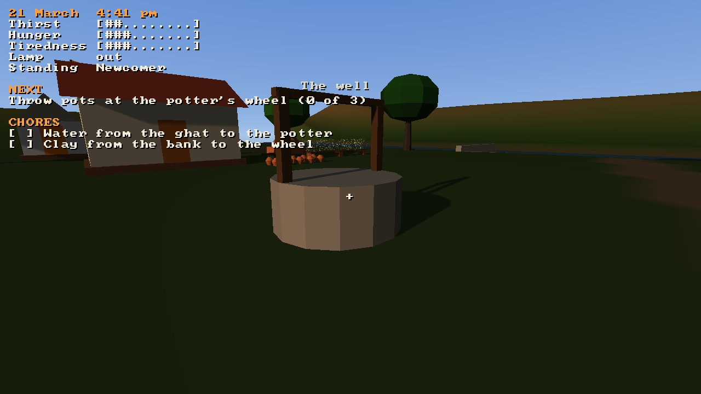 | 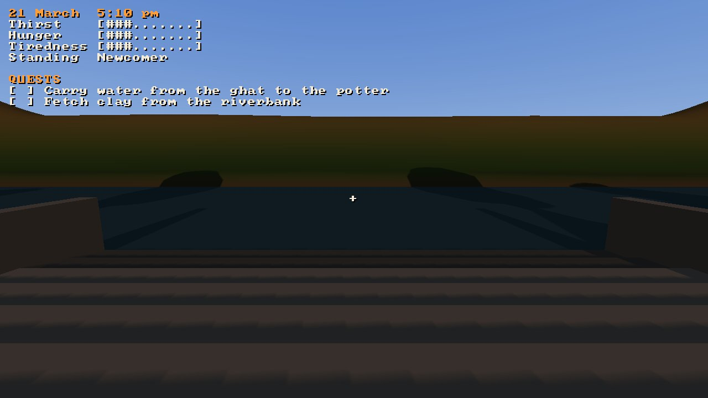 |

| The village from the ghat | Sunset over the river, just after six |
|---|---|
| 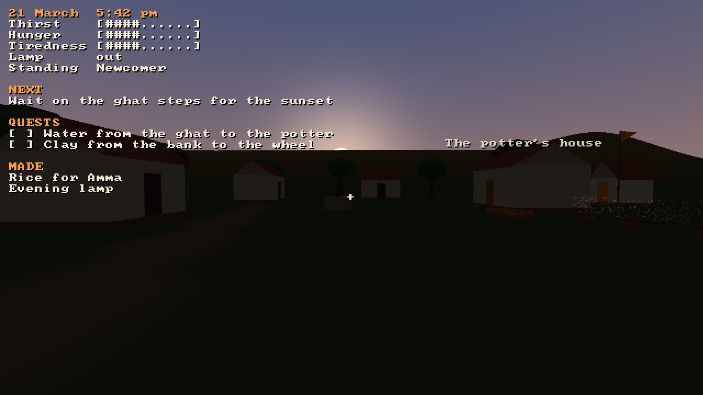 | 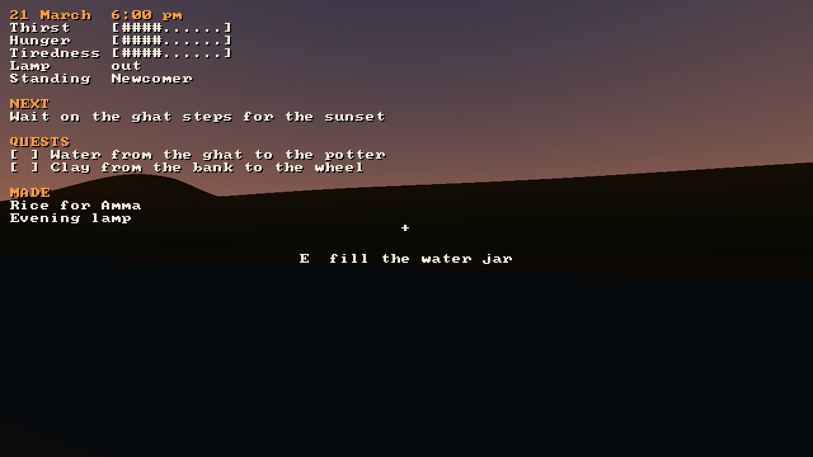 |

| Lamplight on a snake at half past seven | It was a rope |
|---|---|
| 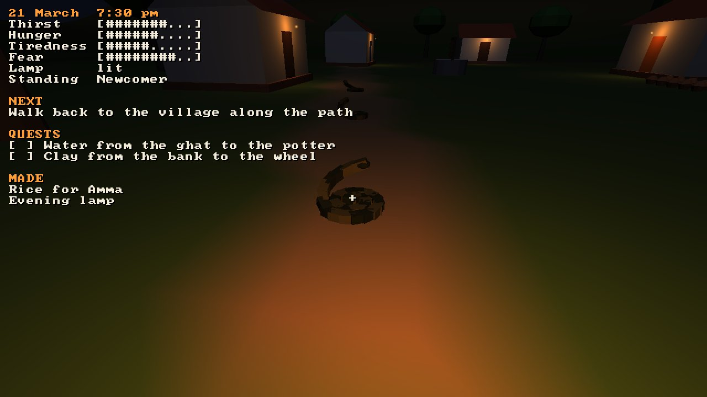 | 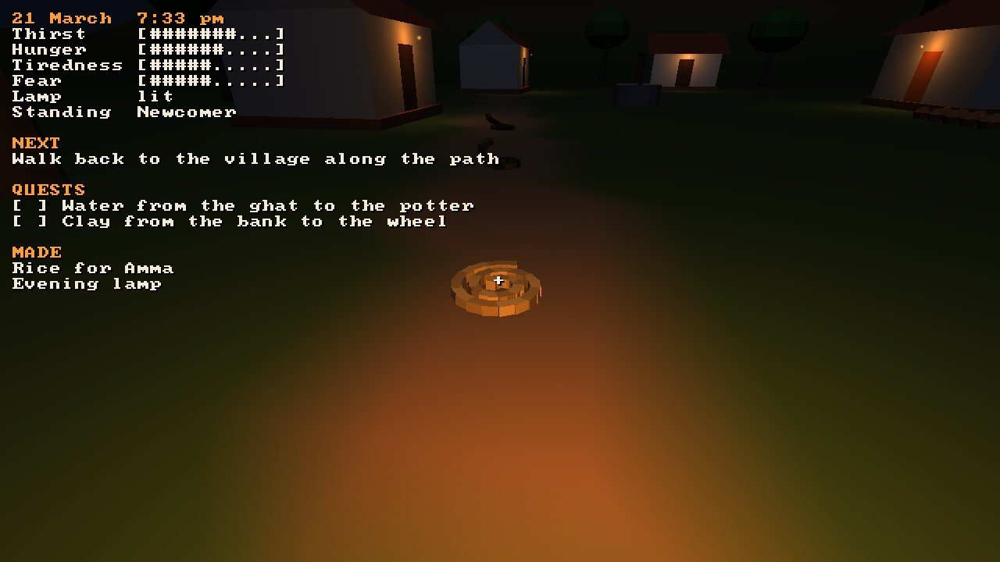 |

| Throwing a water jar | Three pots, three names |
|---|---|
| 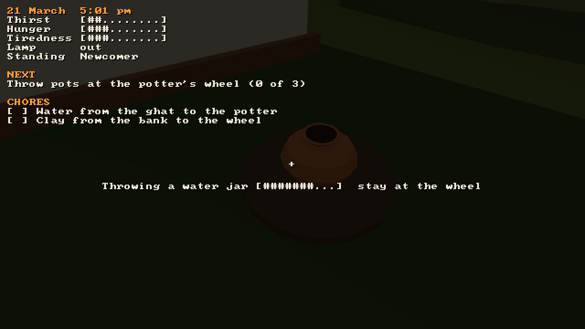 | 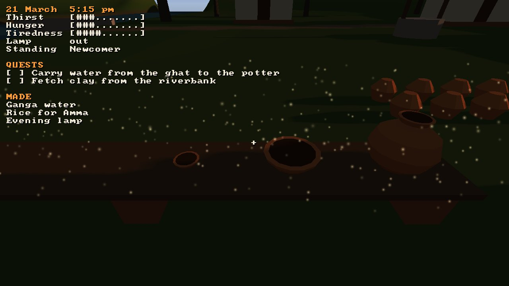 |

| Through the clay lens | The jar broken, the space unmoved |
|---|---|
| 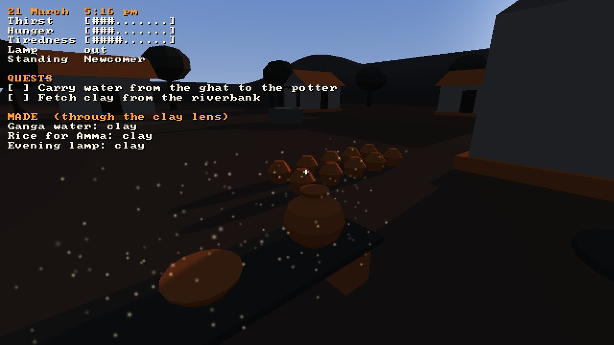 | 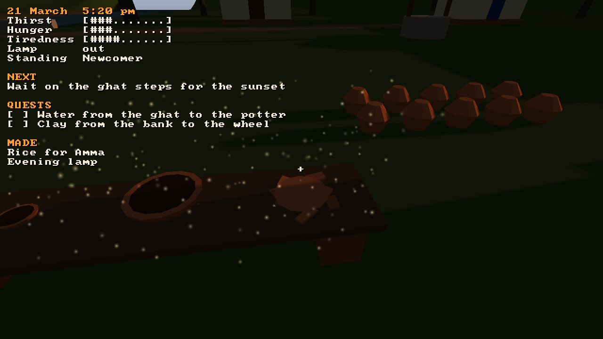 |

| The codex: the rope and the snake | Other schools |
|---|---|
| 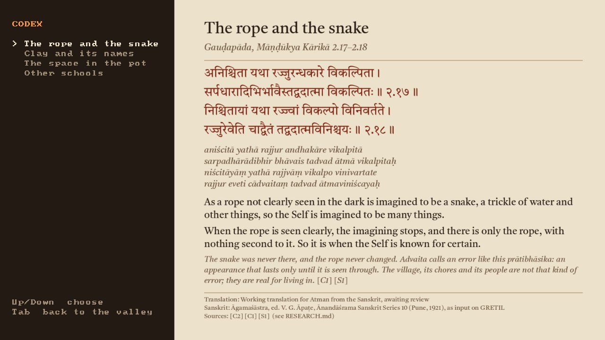 | 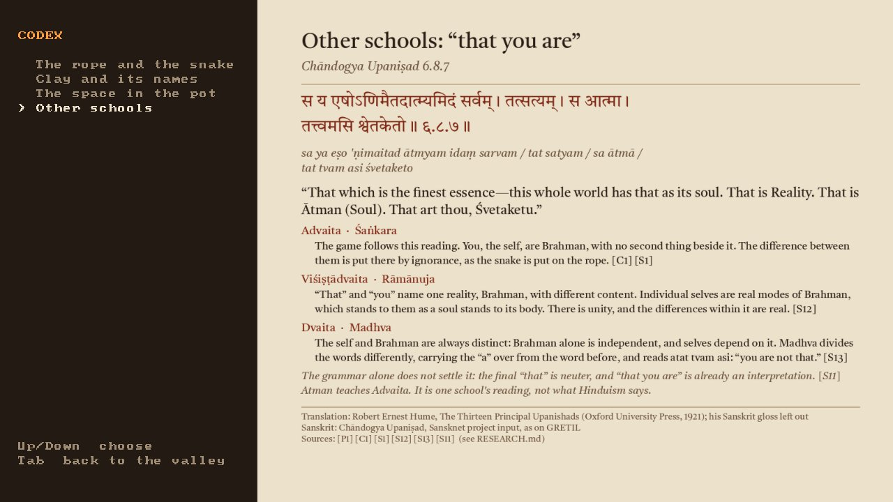 |

| The next morning | Watching the avatar go about its day |
|---|---|
| 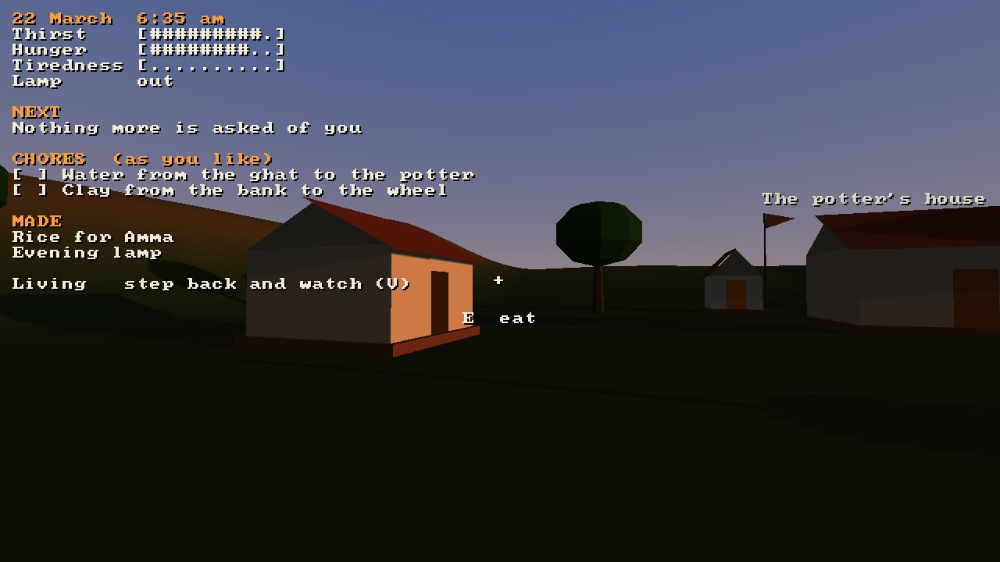 | 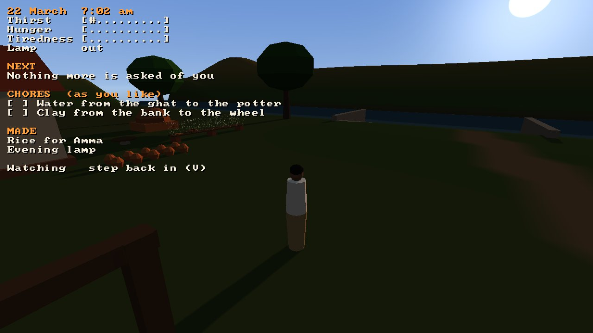 |

*Frames from the game's own headless tour (`atman --headless --tour --frames DIR`).*

## Build and play

Atman builds with CMake 3.24 or newer and a C++17 compiler. Strata, and the SDL3 it uses, are
fetched and built along with it, at the commit `ATMAN_STRATA_REF` in `CMakeLists.txt` pins
(Strata v0.4.0).

```sh
cmake -S . -B build
cmake --build build --config Release
./build/atman               # Windows: build\Release\atman.exe
ctest --test-dir build -C Release
```

On Windows, `tools/play-atman.bat` does all of this in one step. It installs CMake and the Visual
Studio C++ build tools with winget if they are missing, clones or updates `main` into
`%USERPROFILE%\atman-play`, builds the game and starts it. Extra arguments go to the game, for
example `play-atman.bat --tour`, or `play-atman.bat --autopilot --speed 10` to watch the autopilot
play the whole slice at ten times speed.

On Linux, SDL3 needs the X11 development packages (`libx11-dev libxext-dev libxcursor-dev libxi-dev
libxfixes-dev libxrandr-dev libxss-dev`). `cmake -DATMAN_WITH_STRATA=OFF` builds only the
simulation and its tests, with no engine.

| Input | Action |
|---|---|
| Mouse | Look |
| W A S D | Walk |
| Shift | Hurry |
| E | Use what is here: fill the jar, give the water, dig or leave clay, drink, eat, sleep |
| F | Light the lamp, or put it out |
| 1 2 3 4 | At the wheel: throw a water jar, a bowl, a cup or a lamp, then type its name and press Enter |
| B | Break the pot you are looking at |
| C | The clay lens (after three pots) |
| Tab | The codex (Up and Down choose a page; Tab or Esc goes back) |
| V | In the after-mode: step out and watch the avatar (W A S D and the mouse fly), or step back in |
| F1 | Show or hide the controls |
| Esc | Free the mouse (Esc again quits) |

## Documents

| Document | What it covers |
|---|---|
| [CONCEPT.md](CONCEPT.md) | The game: the design problem, the valley, each chapter's teaching and mechanic, teaching rules, tone |
| [MVP.md](MVP.md) | The first playable slice, what "done" means for it, and the milestones |
| [ARCHITECTURE.md](ARCHITECTURE.md) | Code layout, the simulation core, how each mechanic maps to Strata, text, saves, tests |
| [RESEARCH.md](RESEARCH.md) | Sources: Upaniṣads, Śaṅkara and later Advaita, modern scholarship, Alan Watts and other modern teachers, related games, and a verification log |

## Approach to the teaching

- The doctrine follows classical Advaita as taught by Śaṅkara and the Upaniṣads he commented on.
- Modern voices such as Alan Watts, Swami Vivekananda and Ramana Maharshi shape the tone, and the
  game labels them as later readings.
- Other Vedānta schools (Viśiṣṭādvaita, Dvaita) read the same verses differently, and the game says
  so.
- Every verse shown in the game is cited with its source, verse number and translator.
- The game never awards a score or achievement for liberation.
- An academic and a teacher from a living Advaita lineage review the game before a build is
  published.

Corrections from people who know this tradition are welcome as issues.

## Checking the docs

`python3 tools/check_docs.py` checks that every relative link and heading anchor resolves, and that
every citation ID (such as [P1]) is defined in RESEARCH.md. CI runs it on every pull request.

## The codex plates

Strata draws ASCII text only, so each codex page is an image ("plate") made ahead of time from
`content/codex/*.json` and committed under `content/plates/`. After changing an entry, run
`python3 tools/plates/make_plates.py` (it needs Pillow built with libraqm, for Devanagari shaping).
`python3 tools/plates/make_plates.py --check` needs nothing beyond Python. It checks that every
citation is defined, every entry names a translator, and every plate is current. CI runs it.

## License

[MIT](LICENSE). The plates are set in Tiro Devanagari Sanskrit, under the SIL Open Font License
([tools/plates/fonts/OFL.txt](tools/plates/fonts/OFL.txt)). The game decodes them with
[stb_image](https://github.com/nothings/stb) (public domain or MIT, `third_party/stb/`).
