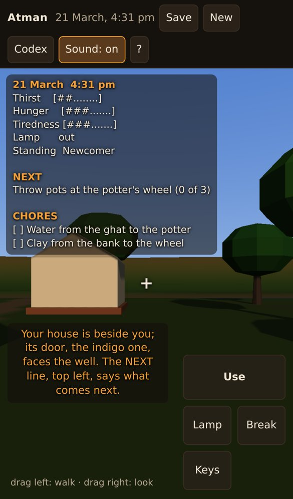
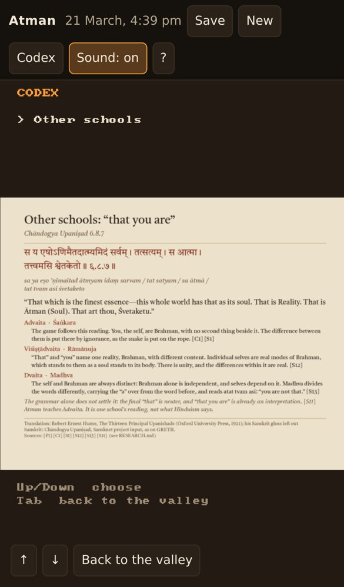

# Playtest: Atman 0.1.1 candidate

No one has played this build by hand. 0.1.1 is a usability round on top of 0.1.0
([#15](https://github.com/Preponderous-Software/atman/pull/15)), found by rendering the tour again
in a landscape and an upright window and by reading the phone smoke test's screenshots; the
owner's notes on 0.1.0 are in [../0.1.0/](../0.1.0/README.md). What was checked, and how:

| | |
|---|---|
| Build | `main` at `6698fe0` (#16, which changed only docs after #15), with the version set to 0.1.1 |
| Date | 2026-10-23 |
| Player | the autopilot and the smoke test (headless), not a person |

## What was checked

| Check | Result |
|---|---|
| `atman --headless --autopilot` (the whole MVP played by the autopilot) | ends at 12:00 pm on day 1 on the pinned fingerprint `7e91db2a0f1ce16c` |
| `atman --headless --tour` at 1280x720 and 720x1280 | every frame renders; the upright codex shows the page across the width; fingerprint `fd01df7f5ce7e429` |
| `web/smoke/smoke.cjs`, iPhone 13 profile | passes: the greeting sits left of the button pad, the codex page fills the width |
| `ctest` (11 suites) | all pass |

| The new game's greeting on a phone | The codex on a phone held upright |
|---|---|
|  |  |

## Not yet checked by hand

- Everything on the 0.1.0 list: the sound on real hardware, and the night's lighting on a real GPU.
- The codex on a real phone held upright.
