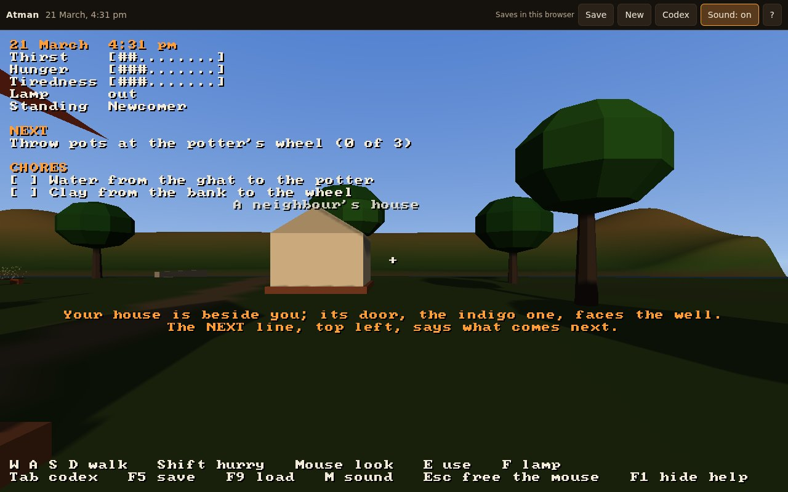
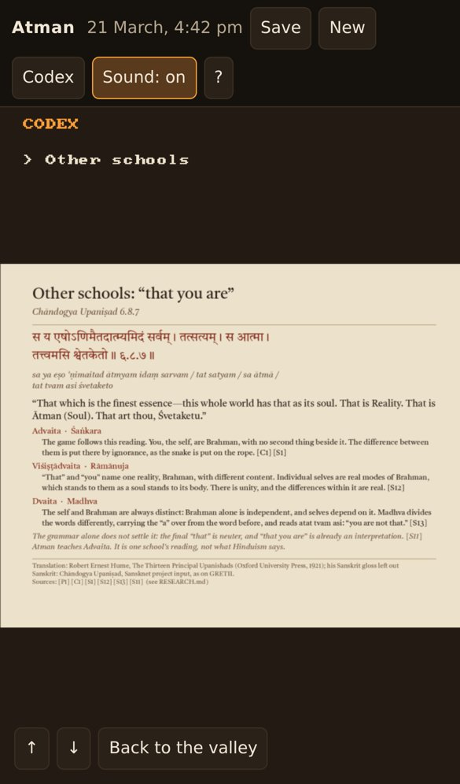

# Playtest: Atman 0.1.2 candidate

No one has played this build by hand. 0.1.2 is a third usability round on top of 0.1.1
([#18](https://github.com/Preponderous-Software/atman/pull/18)), found from the tour and the smoke
test's desktop and phone screenshots; the owner's notes on 0.1.0 are in
[../0.1.0/](../0.1.0/README.md). What was checked, and how:

| | |
|---|---|
| Build | `main` at `87db9e2` (#18), with the version set to 0.1.2 |
| Date | 2026-10-23 |
| Player | the autopilot and the smoke test (headless), not a person |

## What was checked

| Check | Result |
|---|---|
| `atman --headless --autopilot` (the whole MVP played by the autopilot) | ends at 12:00 pm on day 1 on the pinned fingerprint `7e91db2a0f1ce16c` |
| `atman --headless --tour` at 1280x720 | every frame renders; at dusk a place's name keeps a gap after the HUD's words; fingerprint `fd01df7f5ce7e429` |
| `web/smoke/smoke.cjs`, desktop and iPhone 13 profiles | both pass: the greeting is under the crosshair, clear of the HUD, and the phone's codex names no keys |
| `ctest` (11 suites) | all pass |

| The new game's greeting in a desktop browser | The codex on a phone |
|---|---|
|  |  |

## Not yet checked by hand

- Everything on the 0.1.0 and 0.1.1 lists: the sound on real hardware, the night's lighting on a
  real GPU, and the codex on a real phone held upright.
- The touch pad without its Keys button, on a real phone.
