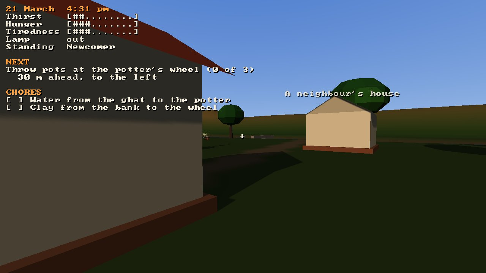
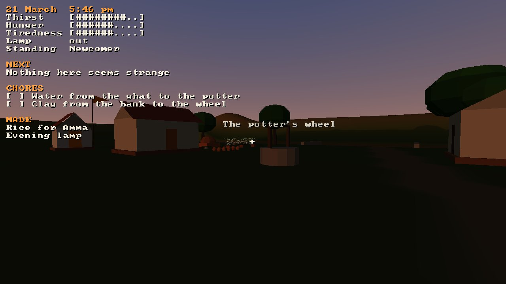

# Playtest: Atman 0.2.0 candidate

No person has played this build by hand. Its evidence is one AI playtest of 0.1.2, what was
changed because of it, and the automated checks on the candidate. The owner's notes on 0.1.0 are in
[../0.1.0/](../0.1.0/README.md).

| | |
|---|---|
| Build | `main` at `822a588` (#26, which drives the game for playtests and pins Strata `7f0c23e`), with the version set to 0.2.0 |
| Date | 2026-10-24 |
| Players | one AI agent (on 0.1.2), the autopilot and the smoke test, not a person |

## The AI playtest (0.1.2, before this release's changes)

One agent played 0.1.2 (`24c9de9`) for about twelve minutes through
[playtester](https://github.com/Preponderous-Software/playtester)'s Atman profile, from
screenshots alone, on a heavily loaded machine. It threw, named and broke pots, used the clay lens
and read two codex pages; it never reached dusk or the snakes. Asked what the game was about, it
answered: "An unhurried village life in which ordinary chores carry a teaching from Advaita
Vedanta: that the many things and selves are names and shapes on one reality." Nothing felt
preachy to it; it found the "Other schools" page fair.

| Its finding | What was done |
|---|---|
| (major) Nothing says where the potter's wheel is; it spent nine minutes looking | A line under NEXT says which way the next place is and how far ([#25](https://github.com/Preponderous-Software/atman/pull/25)) |
| (major) Standing beside the wheel, keys did nothing | Within five metres the prompt says "Step up to the wheel to throw a pot" (#25) |
| (major) On a loaded machine the clock outran a lost player | Not changed: the clock follows real time, a game minute a second, and each of the agent's look-and-screenshot cycles took many real seconds under a load average near 35. A player who misses dusk meets the snakes the next night |
| (minor) Codex footers point to RESEARCH.md, which a player does not have | Not changed yet |
| (minor) HUD text washes out against lamp-lit walls | A larger text size (F2) was added ([#22](https://github.com/Preponderous-Software/atman/pull/22)); the text keeps its shadow |
| (minor) Mouse look turns by different amounts | Not reproduced; likely the harness's synthetic mouse under load |
| (polish) Labels overlap the HUD | 0.1.2 already keeps a gap after the HUD's words ([#18](https://github.com/Preponderous-Software/atman/pull/18)); the agent's case was not reproduced |

## Automated checks on the candidate

| Check | Result |
|---|---|
| `atman --headless --autopilot` (the whole game, now with the dream and the deep sleep) | ends at 12:00 pm on day 1 on the pinned fingerprint `b0790a95717290be` |
| `atman --headless --tour` at 1280x720 | all 28 frames render, including the dream, the deep sleep, both new codex pages, a lamp night and the egrets |
| `web/smoke/smoke.cjs`, desktop and iPhone 13 profiles | both pass, including switching to the second village and back |
| `ctest` (12 suites, natively and as wasm) | all pass, including saves written by 0.1.2 loading in the new format |

| The bearing under NEXT | The dream | Deep sleep |
|---|---|---|
|  |  |  |

## Not yet checked by hand

- The dream and the deep sleep: whether the backwards sun reads as a dream, and the deep sleep as
  sleep rather than a hang.
- F2, F3 and F6 in the desktop game; the lamp night's brightness on a real GPU.
- Everything on the earlier lists: the sound by ear, the night's lighting on a real GPU, the codex
  on a phone held upright, the touch pad.
- The translations: [REVIEW.md](../../REVIEW.md) is ready for a reviewer.
