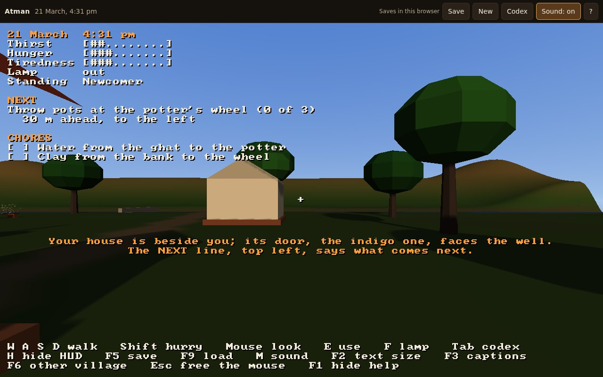
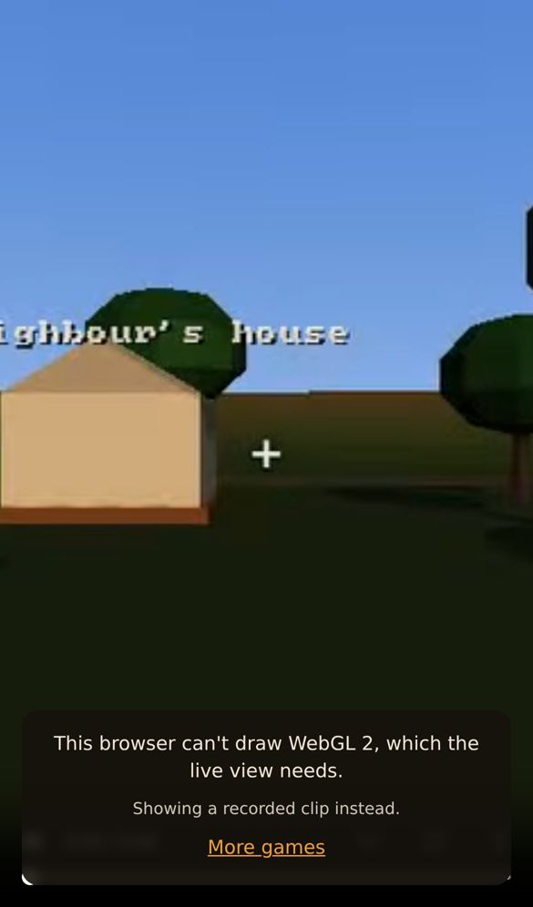

# Playtest: Atman 0.3.0 candidate

No person has played this build by hand. Its evidence is a driven AI playtest of five sessions, the
web smoke test against the live arcade build, and the automated checks on the candidate. It replaces
the first run in this directory, which tested `e1b80d3` and found
[#37](https://github.com/Preponderous-Software/atman/issues/37).

| | |
|---|---|
| Builds | Sessions: `b4bde32` (#39, the fix for #37) for s01 to s04, and `ccf8e99` (#42) for s05. Automated checks and the web smoke test: `bdc802d`, `main` when this was filed, which still says 0.2.1 |
| Date | 2026-10-29 |
| Players | The playtest's coordinating agent, through playtester's `atman-strata` profile, the autopilot and the smoke test; not a person |

What changed in the game after the first run:

- `b4bde32` (#39): the dream and the deep sleep say that they pass by themselves (#37).
- `ccf8e99` (#42): the sunset wait on the ghat steps shows how far the sun has gone down, with a
  message and the shrine's bell at dusk (#40). HUD lines that are too wide wrap instead of running
  off the right edge (#41).
- `edcb32f` (#43): Strata v0.7.0, with the loading shell's web kit 1.1. Strata's notes say that the
  engine, its ABI and its pixels are the same as v0.6.0's. No session played this commit. The
  autopilot, the tours and the web smoke test below did.
- `bdc802d` (#38) added the first run's evidence and changed nothing in the game.

## The AI playtest

[Five sessions](ai-playtest/README.md) played the desktop build headless. All five reached their
goals. No blocker, no major finding and no crash were found, and no issue was filed.

[#37](https://github.com/Preponderous-Software/atman/issues/37) is fixed. The four sessions that
slept all went through the dream and the deep sleep to the morning. None took the sleep for a hang.
In the dream, NEXT says "Nothing to do; the dream passes by itself". V says "Nothing is asked of you
in sleep; it passes by itself." The deep sleep shows "Deep sleep. Morning comes by itself." under
the breathing point. s05 found #42's two changes working on `ccf8e99`.

All five sessions were driven by one agent, which had read the fixes before it played. No further
agents could be started for this run. These sessions check that the fixes show and that nothing
regressed. They are not five fresh readings of the game, as the first run's four agents were. The
[AI playtest's README](ai-playtest/README.md) says more.

The minor findings are listed there. The ones that remain on `main` are: the waking message is cut
off at the bottom after V; aiming at a pot on the drying board is fiddly; the HUD can cover a snake
at 640x360; and "Go home" points through the house.

## The browser build

`web/smoke/smoke.cjs` from `bdc802d` was run against the live arcade
(`https://atman.play.danielstephenson.dev/`, deployed from `bdc802d`). The desktop and iPhone 13
profiles both passed. On the phone profile, the first attempt timed out while it took the screenshot
for the case without WebGL 2, after every check before it had passed. The second attempt passed in
full. In both profiles the loading shell showed and then cleared. Without WebGL 2 the shell shows the
trailer and says why, and none of the engine downloads. Walking, looking, the wheel (desktop), saving
and reloading, and the second village all worked.

| Desktop, after loading | Phone, without WebGL 2 |
|---|---|
|  |  |

## Automated checks

| Check | Result |
|---|---|
| `atman --headless --autopilot` (local, llvmpipe) at `b4bde32`, `ccf8e99` and `bdc802d` | at each, ends at 12:00 pm on day 1 on the pinned fingerprint `b0790a95717290be` |
| `atman --headless --tour` at 1280x720 and 640x360 (local) at `ccf8e99` and `bdc802d` | all 28 frames render at both sizes |
| playtester `pt smoke --profile atman-strata` at `b4bde32` and `bdc802d` | PASS |
| CI on `bdc802d`: Docs, Rules and tests (Linux), Game (Linux, headless tour), Game (Windows, MSVC), Web build and smoke test (headless Chromium) | all passed |

## Not yet checked by hand

- The loading shell on a real phone and a real desktop GPU.
- The dream and the deep sleep as a person sees them, the sound by ear (now with the shrine's bell
  at sunset), the night's lighting and the lamp night on a real GPU, and F2, F3, F6 and H in the
  desktop game.
- The translations: [#28](https://github.com/Preponderous-Software/atman/issues/28) asks for a review.
